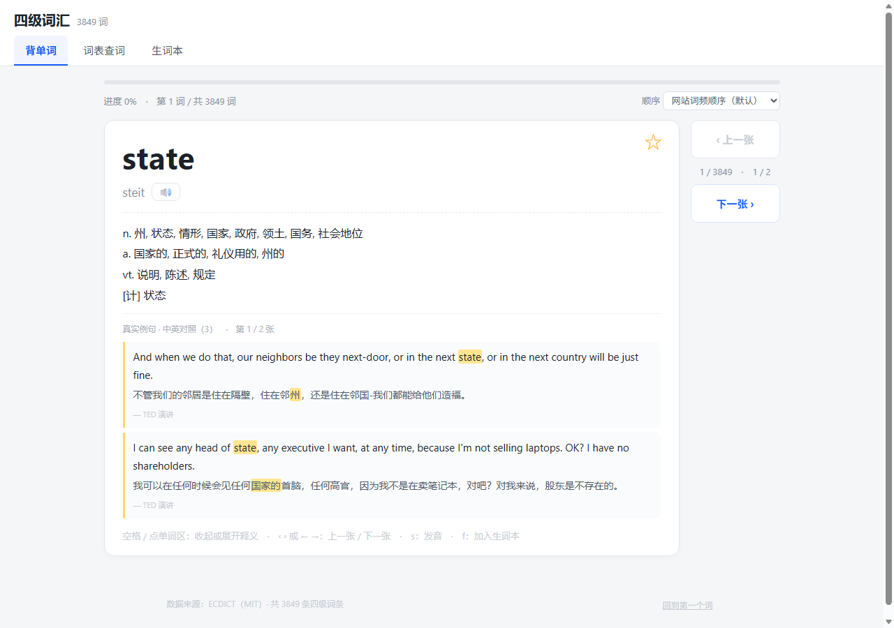
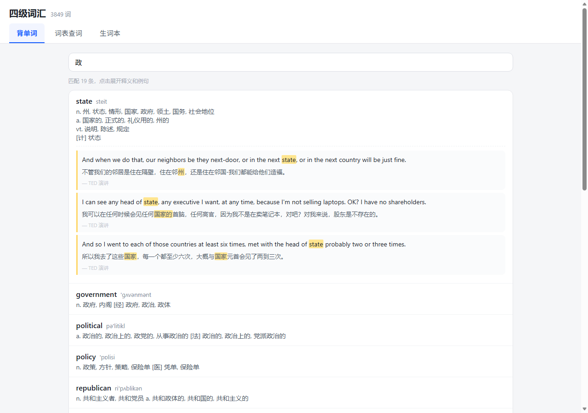

# 四级词汇 · 离线背单词

一个纯前端、可离线使用的大学英语四级背单词应用。同一份前端代码打包成三种形态：

| 形态 | 文件 | 说明 |
|---|---|---|
| 单文件网页 | `四级词汇.html` | 双击即用，数据内嵌，浏览器离线可跑 |
| Windows 桌面 | `四级词汇.exe` | Electron 打包，免安装单文件 |
| Android | `四级词汇.apk` | WebView 套壳，可安装到手机 |

三端成品在 [Releases](https://github.com/zouzt456/cet4-vocab/releases) 里，资产名用 ASCII：`cet4-vocab.html` / `cet4-vocab.apk` / `cet4-vocab.exe`。

词库共 **3849** 个四级词条（来自 ECDICT 中 `tag` 含 `cet4` 的条目，100% 有中文释义）。官方大纲约 4500 词，ECDICT 少标约 650 个；本项目**不自行补词**，宁可缺也不编。




## 功能

- **双卡 / 单卡两种学习模式**：双卡左侧是单词，右侧是剩余例句；单卡一屏一张，长词自动缩字号。
- **卡片交互**：空格或点卡片展开/收起释义，`←` `→` 切换上下词，`s` 发音，`f` 加入生词本。
- **三种排序**：网站词频顺序（默认）、字母序、随机。
- **词表查词**：按英文或中文搜索，点「看卡片」跳转过去。
- **生词本**：收藏、撤回、清空（自绘确认框，避免误触）。
- **进度记录**：认识 / 不认识分别计数，进度条 + 已掌握数，存在 `localStorage`。
- **进度同步**：导出 / 导入 JSON，生词本、模式、停在的词、排序方式一起搬。
- **离线发音**：走浏览器 `speechSynthesis`，不需要联网。
- **夜间模式**：持久化，可手动切换。

## 数据来源

- 词典：[ECDICT](https://github.com/skywind3000/ECDICT)（MIT），字段 `word / phonetic / translation / pos / collins / oxford / bnc / frq / tag / exchange / definition`。
- 例句：从 Tatoeba 的 TED2013、News Commentary、WikiMatrix、QED 等中英句对里筛出，句子长度与中文侧质量都有过滤，每条最多 3 句。
- 例句与释义均为**离线内嵌**，运行时零网络请求。

## 目录结构

```
src/template.html     前端模板（占位符 __DATA__ / __EX__）
data/cet4.json        3849 条词条
data/cet4.bnc.json    按 BNC 词频排好序的版本
data/examples.json    例句（按词小写索引）
scripts/gen.py        从 ecdict.csv 抽 cet4 → data/cet4.json
scripts/mkexamples.py 从语料里挖例句
scripts/finalize_ex.py 例句清洗（别名补齐、繁体/错配过滤、去重）
scripts/build.py      模板 + 数据 → dist/四级词汇.html
scripts/check*.js     Node + DOM 桩的无头测试（翻面、标记、搜索、同步、主题）
dist/                 构建产物（不入库，见 Releases）
```

## 本地构建

```bash
# 1) 准备词典：把 ECDICT 的 ecdict.csv 放到仓库根目录
#    https://github.com/skywind3000/ECDICT  （约 66 MB）
python scripts/gen.py        # → data/cet4.json
python scripts/build.py      # → dist/四级词汇.html
```

例句相关的 `mkexamples.py` / `finalize_ex.py` 需要额外的 Tatoeba 语料包（`corpus/*.zip`，未入库），
仓库里已带处理好的 `data/examples.json`，一般不需要重跑。

## 测试

```bash
node scripts/check.js          # 数据条数、翻面、标记、搜索、生词本
node scripts/check_mode.js     # 双卡/单卡切换
node scripts/check_sync.js     # 导入导出
node scripts/check_theme.js    # 夜间模式
node scripts/check_confirm.js  # 自绘确认框
```

这些脚本用 Node 的 `vm` 造一个最小 DOM 桩，直接调用页面里的全局函数断言，不需要浏览器。

## 许可

- 代码：MIT
- 词典数据：ECDICT，MIT
- 例句：Tatoeba，CC-BY 2.0 FR（例句旁的 `— TED 演讲` 等标注保留来源）

## 已知不足

- 词表比官方大纲少约 650 词（见上）。
- 例句覆盖不均匀：高频词多、低频词少，少数词没有例句。
- 只有中文释义 + 英文释义，没有词根词缀、记忆法。
